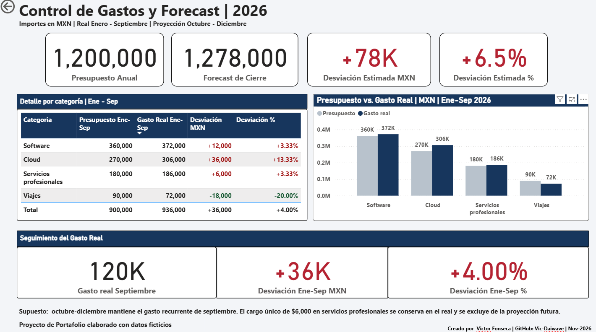

# Vennett 01 | Control de Gastos y Forecast 2026

Proyecto de portafolio en Power BI para comparar presupuesto contra gasto real, identificar desviaciones por categoría y estimar el cierre anual.

*Todos los datos son ficticios. Importes en MXN.*

## Dashboard

## Objetivo

Responder tres preguntas:
- ¿Cómo va el gasto real frente al presupuesto?
- ¿Qué categorías explican las desviaciones?
- ¿Cuál sería el cierre anual si se mantiene el gasto recurrente de septiembre?

## Resultados principales

| Indicador | Resultado |
|---|---:|
| Presupuesto anual | $1,200,000 |
| Forecast de cierre | $1,278,000 |
| Desviación estimada anual | +$78,000 / +6.5% |
| Presupuesto enero-septiembre | $900,000 |
| Gasto real enero-septiembre | $936,000 |
| Desviación enero-septiembre | +$36,000 / +4.00% |

Cloud es el principal impulsor del sobregasto anual proyectado, con una desviación de +$72,000. Los ahorros en Viajes compensan parcialmente los incrementos de las otras categorías.

## Metodología del forecast

Forecast de cierre = gasto real enero-septiembre + proyección octubre-diciembre.

La proyección utiliza el gasto recurrente de septiembre multiplicado por tres:

- Gasto real de septiembre: $120,000.
- Cargo único en servicios profesionales: $6,000.
- Base mensual recurrente: $114,000.
- Proyección octubre-diciembre: $342,000.

El cargo único permanece en el gasto real y se excluye únicamente de la proyección futura.

## Herramientas y funcionalidades

- Excel como fuente de datos.
- Power BI Desktop para el reporte.
- Medidas DAX con SUM, CALCULATE y DIVIDE.
- Variaciones absolutas y porcentuales.
- Formato condicional: rojo para sobregasto y verde para gasto inferior al presupuesto.
- Selección de categorías para explorar los indicadores.

## Archivos

- Vennet_01_Gastos.pbix: reporte de Power BI.
- Gastos_2026.xlsx: datos ficticios.
- Dashboard.png: vista del reporte.

## Cómo utilizarlo

1. Descarga el archivo PBIX y el Excel.
2. Abre el PBIX en Power BI Desktop.
3. Para actualizar los datos, ajusta la ruta del archivo Excel en la configuración del origen de datos.
4. Selecciona una categoría en la gráfica para explorar sus resultados; vuelve a seleccionarla para recuperar los totales.

## Alcance

Caso de práctica con datos de enero a septiembre de 2026. El forecast utiliza septiembre como base, un ajuste fijo de $6,000 y presupuestos mensuales constantes. No incorpora estacionalidad ni predicción estadística.

## Autor

Víctor Fonseca  
GitHub: [Vic-Daiwave](https://github.com/Vic-Daiwave)
